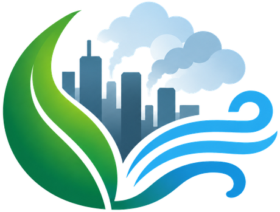
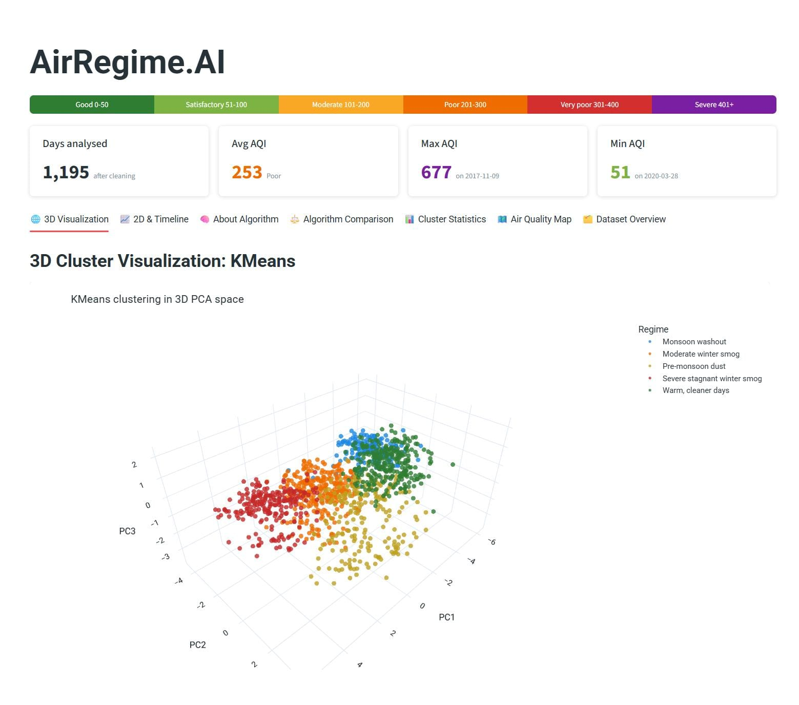
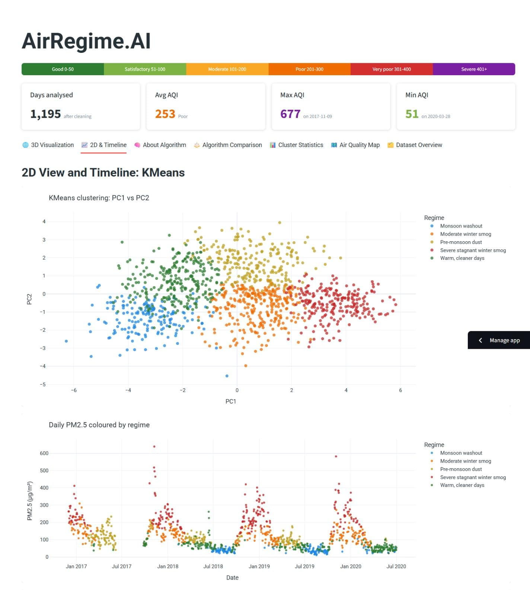
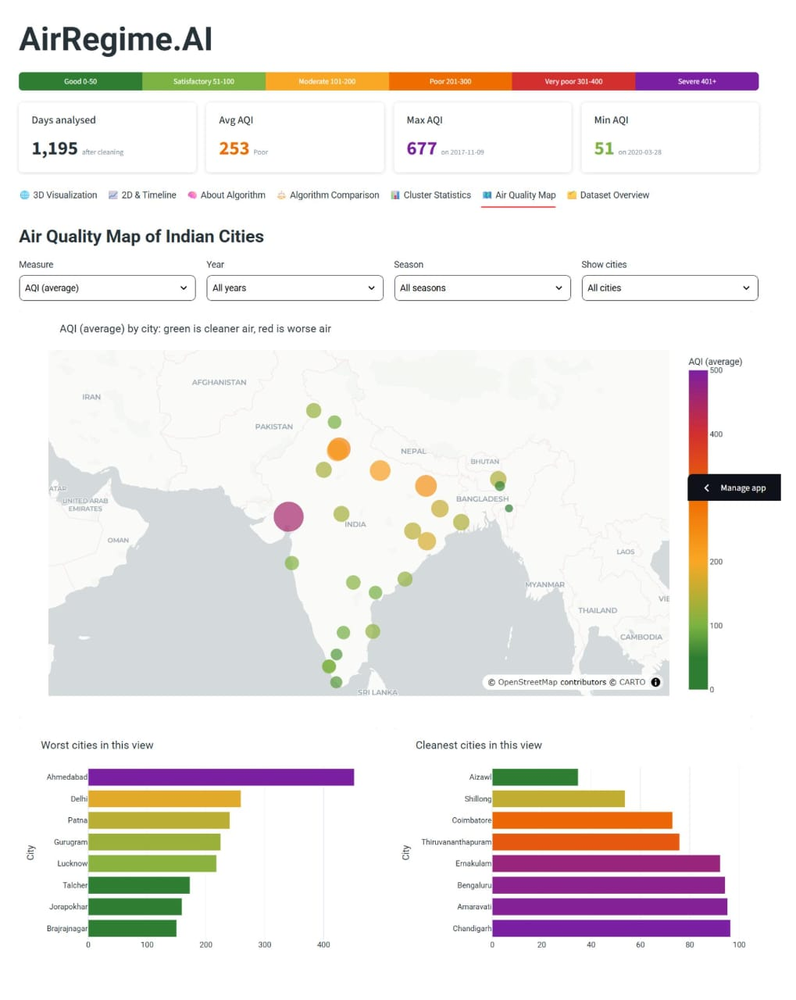

<div align="center">



# AirRegime.AI
### Discovering Delhi's air pollution regimes with unsupervised machine learning


</div>

---

## About the project

Delhi's air quality does not just get "better" or "worse". It moves through recurring **regimes**: monsoon washouts, winter smog, pre-monsoon dust and cleaner warm days. This project asks a simple question:

> **Can clustering find these regimes from pollutant and weather data alone, without ever looking at the AQI?**

I combined daily CPCB pollution data for Delhi with Open-Meteo weather data, engineered features, and compared three clustering algorithms: **KMeans, HDBSCAN and Gaussian Mixture**. The results are shown in an interactive Streamlit dashboard.

**Live app:** [https://air-pollution-regimes.streamlit.app](https://air-pollution-regimes.streamlit.app/)

## Screenshots

All screenshots show **KMeans (k=5)**, the final model.

### 3D Cluster Visualization


### 2D View and Timeline


### Air Quality Map of Indian Cities



## Key findings

| Method | Regimes | Noise | Silhouette | Stability (ARI) |
|---|---|---|---|---|
| **KMeans (k=5), final choice** | 5 | 0% | 0.203 | **0.974** |
| Gaussian Mixture (k=5, no SO2) | 5 | 0% | 0.083 | 0.620 |
| HDBSCAN (mcs=20, ms=10) | 3 | 74.7% | 0.107 | n/a |

- **KMeans k=5 was chosen.** It is the most stable across random starts, labels every day, and its regimes match real seasons.
- The five regimes: *Monsoon washout, Moderate winter smog, Pre-monsoon dust, Severe stagnant winter smog, Warm cleaner days.*
- **Honest caveat:** silhouette is about 0.2 for every method. Delhi's air changes gradually, so the regimes are tendencies, not sharp categories. HDBSCAN's 75% noise supports this.
- The methods only partly agree with each other (ARI 0.11 to 0.28). Only the monsoon washout is found by all three.

## Dashboard features

Pick an algorithm in the sidebar and every tab updates:

| Tab | What it shows |
|---|---|
| 3D Visualization | Rotatable PCA scatter of the regimes, with selectable axes |
| 2D & Timeline | 2D view, daily PM2.5 coloured by regime, regime-by-month heatmap |
| About Algorithm | Plain-language definition, settings used, strengths, limits, and whether it was chosen |
| Algorithm Comparison | Metrics table and charts, agreement heatmap, final decision |
| Cluster Statistics | Regime profiles, AQI box plots, radar fingerprint, regimes by year, **Day Explorer** with health note |
| Air Quality Map | 26 Indian cities coloured green (cleaner) to red (worse) by year, season and measure |
| Dataset Overview | Pipeline, cleaning decisions, seasonal charts, correlations, PCA, feature guide |

## Data

| Source | Use |
|---|---|
| [CPCB city-wise air quality (Kaggle `city_day.csv`)](https://www.kaggle.com/datasets/rohanrao/air-quality-data-in-india) | Daily pollutants and AQI for 26 Indian cities, 2015 to 2020 |
| [Open-Meteo historical weather API](https://open-meteo.com/) | Daily temperature, rainfall, wind speed and direction for Delhi |

Delhi has 2,009 daily rows (2015-01-01 to 2020-07-01). After cleaning, **1,195 days** (Dec 2016 onward) were used for clustering.

## Method

1. **Data collection:** merge Delhi pollution data with Open-Meteo weather on date.
2. **EDA:** pollution peaks from October to January, and April to June is dusty (high PM10, low PM2.5).
3. **Cleaning:** dropped sparse columns, treated zeros as missing, removed the 2017 sensor outage, dropped impossible values, interpolated short gaps only.
4. **Feature engineering:** 9 pollutants, PM2.5/PM10 ratio, temperature, rain, wind speed and wind direction as sine and cosine. AQI, NOx, Toluene and calendar flags (Diwali, stubble season, monsoon, lockdown) are kept for validation only and never used for clustering.
5. **Scaling and PCA:** log transform and standardisation. PCA is used for visualisation.
6. **Modelling:** KMeans, HDBSCAN and Gaussian Mixture, with k selection by inertia, silhouette, Davies-Bouldin and seed stability.
7. **Comparison:** metrics, Adjusted Rand Index between methods, and overlap of regimes.
8. **Regime profiling:** naming each regime from its pollutant and weather profile.
9. **Validation:** checking the regimes against context flags (Diwali, stubble season, monsoon, lockdown) that were never used for clustering.
10. **Export:** the final KMeans model, scaler and PCA are saved in `models/`.

## Project structure

```
.
├── app.py                    # Streamlit dashboard
├── requirements.txt
├── assets/logo.png
├── data/
│   ├── raw/                  # city_day.csv, weather_delhi.csv
│   ├── cleaned/              # delhi_merged.csv, delhi_clean.csv
│   ├── features/             # delhi_features, delhi_context, delhi_scaled, delhi_pca
│   └── results/              # cluster labels, comparison tables, regime profiles
├── models/                   # kmeans_k5, gmm_k5_noSO2, pca6, scaler, regime_config.json
└── notebooks/                # 01 data collection ... 12 export final model
```

## Run it locally

```bash
git clone https://github.com/YOUR-USERNAME/YOUR-REPO.git
cd YOUR-REPO
pip install -r requirements.txt
streamlit run app.py
```

## Limitations

- Regimes are fitted on Delhi only. The city map shows each city's AQI, not regimes.
- Silhouette scores are low (about 0.2), so regime boundaries are soft.
- Dates for Diwali, stubble season and lockdown are approximate and used for validation only.
- Data ends in July 2020, so recent years are not covered.

## Tech stack

Python, pandas, NumPy, scikit-learn (KMeans, HDBSCAN, Gaussian Mixture, PCA), Plotly, Streamlit.

## Author

**Khushi Chandak**, [LinkedIn](https://www.linkedin.com/in/khushiichandak/) | [GitHub](https://github.com/khushichandak27)

*Air quality data: CPCB via Kaggle. Weather data: Open-Meteo. Please check each source's licence before reusing the data.*
